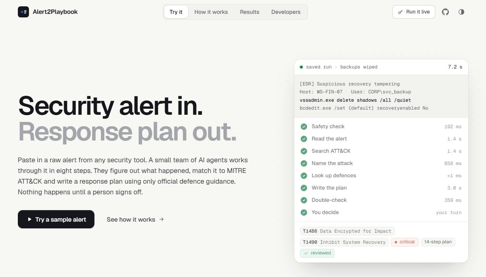
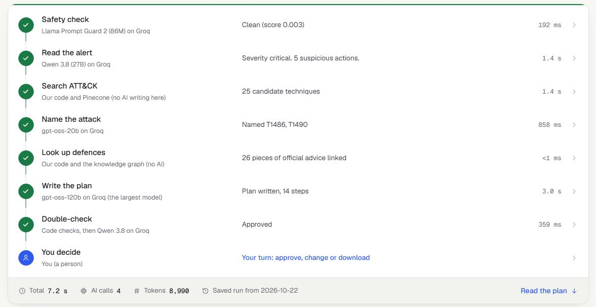
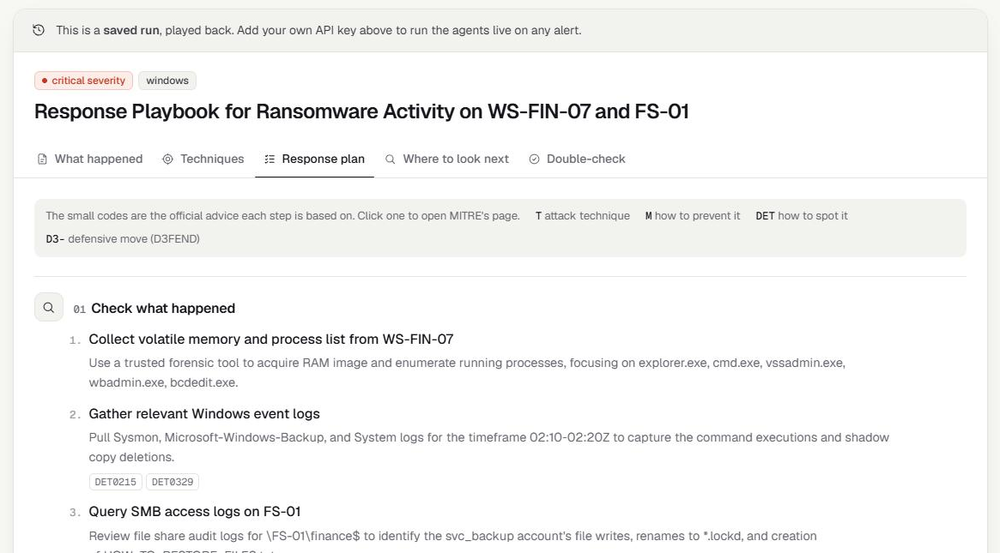
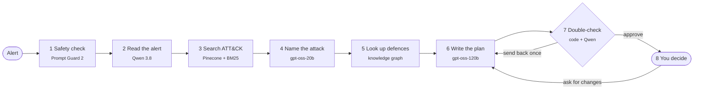
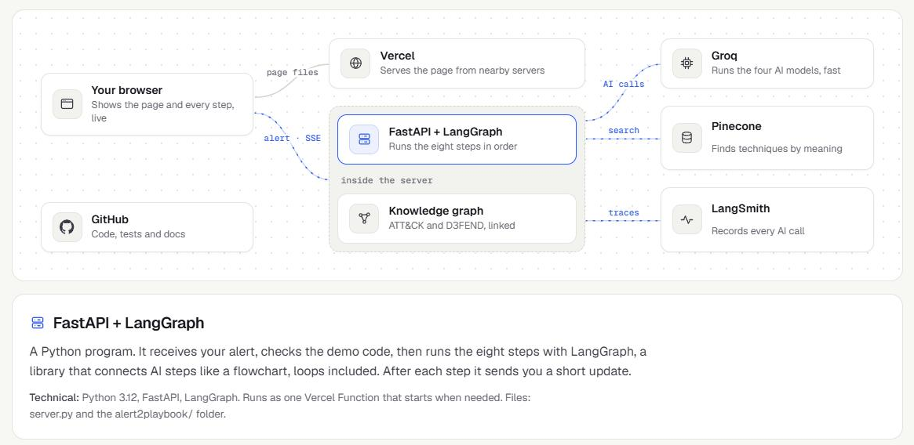
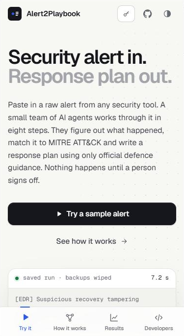

<div align="center">


# Alert2Playbook

### Security alert in. Response plan out.

**Paste in a raw alert from any security tool. A small team of AI agents works out what happened, matches it to MITRE ATT&CK and writes a response plan using only official defence guidance. Then it waits for a person to sign off.**

It takes about seven seconds, and every step shows its work.

[**Open the live demo**](https://alert2playbook-abubakar.vercel.app) · [Read the docs](docs/README.md) · [API reference](https://alert2playbook-abubakar.vercel.app/api/docs) · [Agent Card](https://alert2playbook-abubakar.vercel.app/.well-known/agent-card.json)




</div>

---

## What it actually does

A security tool fires an alert. Something like this:

```text
[EDR] Suspicious recovery tampering
Host: WS-FIN-07   User: CORP\svc_backup
vssadmin.exe delete shadows /all /quiet
bcdedit.exe /set {default} recoveryenabled No
Prior activity: 312 files on \\FS-01\finance$ renamed to *.lockd
```

Someone on a security team now has to answer three questions, fast. What happened? Which known attack is this? What do we do about it?

Alert2Playbook answers all three. For the alert above it says, in plain English, that someone wiped the backups and then encrypted the finance share, which is what ransomware does. It names the two attack techniques from MITRE ATT&CK (T1486 *Data Encrypted for Impact* and T1490 *Inhibit System Recovery*) and quotes the exact line of the alert that proves each one. Then it writes a 14-step response plan in the five phases incident responders already use: check, contain, remove, recover, prevent.

Every step in that plan cites the official advice it's based on, and every one of those citations is checked by code before you see it. Nothing touches a computer. The plan sits there until a person approves it, asks for changes in plain English, or downloads it.

<table>
<tr>
<td width="50%"></td>
<td width="50%"></td>
</tr>
<tr>
<td><b>Watch it think.</b> Each step reports back the moment it's done, with the model it used and how long it took. Click any step to see exactly what went in and what came out.</td>
<td><b>Read the plan.</b> What happened, the techniques with their proof, the plan itself, where to look next, and what the reviewer checked. Every small code links to MITRE's page.</td>
</tr>
</table>

---

## The eight steps



| | Step | Who does it | What it adds |
|---|---|---|---|
| 1 | Safety check | Llama Prompt Guard 2 | A score for hidden instructions aimed at the AI. Alerts contain attacker text, so this matters. |
| 2 | Read the alert | Qwen 3.8 27B | A summary, a severity, the computers and accounts involved, and what the attacker seems to be doing |
| 3 | Search ATT&CK | Pinecone and BM25, no AI | The 25 most likely techniques out of 810, found by meaning *and* by keyword |
| 4 | Name the attack | gpt-oss-20b | One to three techniques, picked only from those 25, each with a quote from the alert as proof |
| 5 | Look up defences | The knowledge graph, no AI | The official mitigations, detections and D3FEND moves for those techniques. These become the only things the plan may cite. |
| 6 | Write the plan | gpt-oss-120b | The response plan, naming the real computers and accounts |
| 7 | Double-check | Code, then Qwen | Code checks every citation is real. A different model family looks for real mistakes. Either one can send the plan back. |
| 8 | You decide | A person | Approve, ask for changes, or download |

Different steps use different models on purpose. The hardest job gets the biggest model, and the reviewer comes from a different family than the writer, so no model is marking its own homework.

---

## Why you can trust what it says

Language models make things up. Most of the work in this project went into making sure that can't reach the person reading the plan.

- **It can only name real attacks.** The mapping agent picks from a shortlist of real ATT&CK techniques, and code throws away any ID that wasn't on it.
- **It can only cite real advice.** The writer only sees the knowledge-graph entries for the techniques it found. Code checks every ID it cites. A made-up one forces a rewrite, and if one somehow survives, it's removed before you see the plan.
- **It has to show its proof.** Every technique comes with the exact words from the alert that support it.
- **It gets a second opinion** from a model built by a different company.
- **It treats the alert as data, never as orders.** A guard model scores every alert for hidden instructions, and every prompt fences the alert off.
- **It can't do anything.** No agent has a tool that touches a system. The worst case is a bad draft, and a person reads every draft.

In the seven saved sample runs the plans cite 96 references between them. All 96 are real MITRE entries.

---

## How well it works

I built 30 test alerts from [Atomic Red Team](https://github.com/redcanaryco/atomic-red-team), where every test is a real attack command with a known answer, and stripped out anything that gave the answer away. Each one is a single bare command with no story around it, so it's harder than a real alert.

| Version | Right technique in the shortlist | Right technique in the final picks | Right family | Picked first | Median time |
|---|---|---|---|---|---|
| First version: keyword search, 15 candidates | 69.0% | 41.4% | 58.6% | 13.8% | 20.8 s |
| **Now: keyword + meaning search, 25 candidates** | **83.3%** | **46.7%** | **60.0%** | **30.0%** | **2.3 s** |

"Picked first" looks low, and here's why. A lot of the test commands run through PowerShell, so the agent often lists PowerShell first. That's not wrong, but it isn't the labelled answer, which usually comes second. That's also why the plan covers up to three techniques.

**Does the meaning search earn its place?** To test it fairly I replayed only the search step with the same inputs every time. Keyword search stops improving at 20 results (71.4%). Keyword and meaning together keep going: 78.6% at 25 and 82.1% at 30. At just 10 results the combined search actually does worse, and I've left that in.

**LangGraph or CrewAI?** I rebuilt the whole pipeline in CrewAI with the same models, prompts, search and checks, then ran both on the same seven alerts:

| | LangGraph (this repo) | CrewAI, same reply limits | CrewAI, bigger reply limits |
|---|---|---|---|
| Finished the job | **7 of 7** | 1 of 7 | 5 of 7 |
| Typical time per alert | **7.2 s** | 9.2 s | 22.9 s |
| Tokens per alert | **~11,700** | ~12,600 | ~21,200 |

CrewAI wraps every call in its own role, goal and "Thought / Final Answer" text. With Groq's models that caused empty replies and answers cut off mid-JSON. Seven alerts is a small sample, so treat it as a direction, not a verdict.

Every number above comes from a results file in [`eval/results/`](eval/results/) and [`benchmarks/`](benchmarks/). The full method is in [docs/07](docs/07-measuring-it.md).

---

## Try it

There are three ways in, and you don't need an account for any of them.

| | How | Cost |
|---|---|---|
| **Watch a saved run** | Pick any of the seven sample alerts and press *Watch a saved run*. It replays a real run step by step. | Free. No AI is called. |
| **Bring your own key** | Paste an API key from any provider on the list, pick a model, and run any alert live. | Your own account. Most providers have a free tier. |
| **The demo code** | For me and the people I give it to. | My Groq key. |

Providers you can bring a key for:

| Free tier | Paid |
|---|---|
| Groq · Google Gemini · OpenRouter · Cerebras · Mistral · Cohere | OpenAI · Anthropic · DeepSeek · xAI · Together AI |

Your key is checked with the provider before anything runs, used for your runs only, and never saved. [Here's exactly what happens to it.](docs/12-your-own-key.md)

<table>
<tr>
<td width="62%"></td>
<td width="38%"></td>
</tr>
<tr>
<td><b>How it works.</b> Every part of the system, the exact messages they send each other and one alert followed through all eight steps with real data.</td>
<td><b>On a phone.</b> The tabs move to the bottom, the alert list scrolls sideways, and a step's details slide up as a sheet you can drag away.</td>
</tr>
</table>

---

## Use it from your own code

The same pipeline is behind three doors.

**Plain HTTP**, streamed as server-sent events, one event per finished step:

```bash
curl -N -X POST https://alert2playbook-abubakar.vercel.app/api/run \
  -H "Content-Type: application/json" \
  -H "X-LLM-Key: YOUR_GROQ_KEY" \
  -d '{"alert": "Sysmon EID 1 on WS-01: schtasks /create /tn upd /tr powershell.exe /sc onlogon /ru SYSTEM",
       "visitor": {"name": "Your Name", "provider": "groq", "model": "openai/gpt-oss-120b"}}'
```

**A2A**, so other AI agents can find it and hire it. They read the [Agent Card](https://alert2playbook-abubakar.vercel.app/.well-known/agent-card.json), send a `SendMessage` JSON-RPC request to `/a2a`, and get back a finished task with the plan as Markdown and as JSON.

**MCP**, so an assistant like Claude can use it as a tool:

```bash
claude mcp add alert2playbook -- python -m alert2playbook.mcp_server
```

That adds three tools: `lookup_technique` and `search_techniques` (no keys needed) and `alert_to_playbook` (needs a Groq key).

All of it is in [docs/08](docs/08-talking-to-other-agents.md).

---

## Security

The public site takes API keys from strangers and runs code that reads attacker-written text, so I treated it like something that will be attacked.

| What | How |
|---|---|
| **Visitor keys** | Only providers on a fixed list, with their addresses written into the code. Keys must be plain tokens of the right shape for that provider, then pass a free check with the provider itself. Used in memory for one run, never stored, never logged, and cut out of any error message. Requests never follow redirects. |
| **What's kept** | A masked copy (`gsk_••••a1b2`) and a one-way fingerprint, so I can see which providers people use without holding a single working key |
| **Abuse limits** | 10 runs an hour per visitor, 20 per key, 300 a day for the whole site, counted in Upstash Redis so they hold across every serverless copy |
| **Owner dashboard** | One login. Only an scrypt hash of the password is on the server. The session cookie is signed, `HttpOnly`, `SameSite=Strict`, scoped to the admin API and lasts 8 hours. Sign-ins are rate limited, and ones from other sites are refused. |
| **The page itself** | A strict Content Security Policy (scripts only from this site, plus one inline script pinned by its hash), HSTS, no framing, and every piece of AI or visitor text escaped before it's shown |
| **Prompt injection** | Guard model, fenced prompts, no tools that act on systems |

The tests check each of these, including that a key never appears in the run log, in an error or in the dashboard's data.

---

## Built with

| | |
|---|---|
| **LangGraph** | The eight steps as a graph with typed state, a review loop, a second entry point for change requests, and step-by-step streaming |
| **Groq** | gpt-oss-120b writes, gpt-oss-20b maps, Qwen 3.8 reads and reviews, Llama Prompt Guard 2 screens. Every answer is a forced tool call checked by Pydantic, with a retry and a fallback model. |
| **Pinecone** | Meaning search over all 810 techniques, using its built-in `llama-text-embed-v2` embeddings so no model ships with the server |
| **BM25 + RRF** | A hand-written keyword search, merged with the meaning search by reciprocal rank fusion |
| **MITRE ATT&CK v20 + D3FEND 1.6** | A 0.4 MB knowledge graph: 706 Enterprise and 104 ICS techniques, 96 mitigations, 807 detection strategies and their D3FEND countermeasures |
| **FastAPI on Vercel** | One serverless Python function for the API, A2A and the dashboard. The page is plain HTML, CSS and JavaScript on Vercel's CDN, with no framework and no build step. |
| **Upstash Redis** | Rate limits and the run log behind the dashboard |
| **LangSmith** | A trace of every AI call, tagged by where it came from |

Everything runs on free plans.

---

## How the code is laid out

```text
alert2playbook/
├── graph.py         the eight steps, the review loop and every code check
├── prompts.py       what each agent is told, and what it's allowed to see
├── schemas.py       the form each agent has to fill in
├── llm.py           calls the models, checks the forms, retries, scrubs keys from errors
├── retrieval.py     keyword + meaning search, merged
├── kb.py            the knowledge graph and keyword search
├── providers.py     which providers a visitor can use, and how a key is checked
├── store.py         rate limits and the run log
├── admin.py         the dashboard login
├── a2a.py           the Agent Card and SendMessage
└── mcp_server.py    the three MCP tools
server.py            the web API
public/              the site and the dashboard
tests/               74 tests, all offline
eval/  benchmarks/   the accuracy test, the search study and the CrewAI comparison
docs/                twelve short pages explaining all of it
```

The split that matters is that **`graph.py` never talks to a model directly.** It talks to anything with a `generate()` method. That's what lets the tests run the whole graph against a scripted fake, and what let me add visitors' own providers without touching the graph at all.

---

## Running it yourself

You need Python 3.12.

```bash
git clone https://github.com/M-AbubakarNadeem/Alert2Playbook.git
cd Alert2Playbook
python -m venv .venv
.venv\Scripts\activate          # macOS or Linux: source .venv/bin/activate
pip install -r requirements-dev.txt
pytest                          # 74 tests, no keys, no internet
```

To run the agents, copy `.env.example` to `.env` and add a free Groq key. Pinecone and LangSmith are optional.

```bash
python scripts/index_pinecone.py    # once, only if you use Pinecone
python scripts/dev.py               # http://127.0.0.1:8000
```

Deploying to Vercel for free, setting up the dashboard and fixing common problems are all in [docs/09](docs/09-run-it-yourself.md).

---

## The docs

Twelve short pages that explain the project in plain words, from "what is an alert" up to every design decision. You don't need to know anything about security or AI to follow them.

[What is this?](docs/01-what-is-this.md) · [Words you need](docs/02-words-you-need.md) · [How it works](docs/03-how-it-works.md) · [The knowledge](docs/04-the-knowledge.md) · [Finding the technique](docs/05-finding-the-right-technique.md) · [Keeping it honest](docs/06-keeping-it-honest.md) · [Measuring it](docs/07-measuring-it.md) · [Talking to other programs](docs/08-talking-to-other-agents.md) · [Run it yourself](docs/09-run-it-yourself.md) · [Map of the code](docs/10-code-map.md) · [Why it's built this way](docs/11-decisions.md) · [Your own key and the dashboard](docs/12-your-own-key.md)

---

## What it can't do

- It knows nothing about your company unless you tell it, through *ask for changes*. The plan is a draft for a person.
- The search shortlist decides what the mapping agent can pick. On one factory alert it chose *Program Download* when the alert described an upload. ICS is only 104 of the 810 techniques.
- On a free Groq key, per-minute limits slow down back-to-back runs. The client waits and retries.
- Small models on some providers can't fill in the agents' forms reliably. The site tells you and suggests a larger one.

---

## Licence

The code is [MIT](LICENSE), © 2026 Muhammad Abubakar Nadeem.

MITRE ATT&CK® is © The MITRE Corporation and is used under the ATT&CK Terms of Use. MITRE D3FEND™ is published by MITRE under the MIT licence. The test alerts are generated locally from Atomic Red Team (© Red Canary, MIT licence) and aren't included in this repository.

<div align="center">

<br>

**Built by Muhammad Abubakar Nadeem**

[LinkedIn](https://www.linkedin.com/in/muhammad-abubakar-nadeem-045b582ba) · [GitHub](https://github.com/M-AbubakarNadeem) · [X](https://x.com/NootAbubakar) · [Email](mailto:abubakarnadeen01234@gmail.com)

</div>
