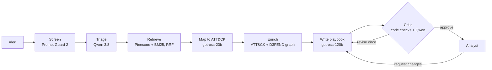

# Alert2Playbook

**Paste a security alert. Get a MITRE ATT&CK mapping and an incident response playbook, grounded in ATT&CK and D3FEND and reviewed by a critic agent before it reaches a human analyst.**

Live demo: **https://alert2playbook-abubakar.vercel.app** · [Documentation](docs/README.md) · [A2A agent card](https://alert2playbook-abubakar.vercel.app/.well-known/agent-card.json) · [API docs](https://alert2playbook-abubakar.vercel.app/api/docs)

Built with LangGraph, Groq (gpt-oss-120b, gpt-oss-20b, Qwen 3.8, Llama Prompt Guard 2), Pinecone, FastAPI, LangSmith and Vercel. It runs on free plans; the live demo uses a paid Groq key, so live runs there need a demo code. Every sample alert can be watched without one: the page replays a saved real run, step by step.

## What it does

An analyst pastes an EDR, Sysmon, auditd, CloudTrail or OT network alert, or builds one with the form on the page. Eight steps run, and the page lights each one up live. Click any step to see exactly what went in and what came out:



The result:

- **ATT&CK mapping:** 1 to 3 techniques, each with the exact alert fragment that proves it.
- **Playbook:** NIST SP 800-61 phases (detection and analysis, containment, eradication, recovery, hardening). Every step cites the ATT&CK mitigations, detection strategies and D3FEND countermeasures it relies on, linked to MITRE's pages.
- **Hunt leads:** which log sources to search for more of the same activity.
- **Analyst controls:** approve, request changes in plain English (re-enters the graph at the writer), or download Markdown.

## Engineering highlights

- **Multi-agent orchestration with LangGraph:** typed shared state, conditional edges, a critic-driven revision loop, human-in-the-loop re-entry, and node-by-node streaming over server-sent events.
- **Hybrid RAG:** Pinecone dense search (integrated `llama-text-embed-v2` embeddings, so no model ships in the function) plus hand-written BM25, fused with Reciprocal Rank Fusion over 8 to 12 queries per alert.
- **Knowledge-augmented generation (KAG):** a knowledge graph of MITRE ATT&CK v20 (706 Enterprise + 104 ICS techniques, 96 mitigations, 807 detection strategies) and D3FEND 1.6 countermeasures. The writer only sees, and may only cite, the graph neighbourhood of the mapped techniques.
- **Grounding enforced in code, not just prompts:**
  - the mapper must pick from retrieved candidates;
  - invented IDs are rejected;
  - the critic's deterministic checks force a revision when a playbook cites anything outside the graph context;
  - unbacked references are stripped before the analyst sees them.
- **Prompt-injection defence:** alerts are attacker-influenced text. Llama Prompt Guard 2 scores every alert, prompts fence the alert as data, and no agent has tools that act on systems.
- **Per-agent model routing on Groq:** the strongest model writes, a different model family reviews, and on the free tier spreading the roles also spreads per-model quotas. Every call is a forced tool call validated by Pydantic, with a reply-length cap, a retry and a fallback-model ladder.
- **Cost control for a public demo:** live runs and A2A calls need a demo code (`X-Demo-Code`, checked in constant time, guesses rate limited, announced in the Agent Card). Samples replay saved runs without spending anything.
- **A self-explaining interface:** four tabs (Try it, How it works, How good is it, For developers). There is an alert builder, a drawer showing each step's real input and output, a map of every message between the parts with its real format, and results read straight from the result files.
- **Interoperability:**
  - an **A2A v1.0** Agent Card and `SendMessage` JSON-RPC endpoint, so other agents can call it;
  - an **MCP** server with three tools (`lookup_technique`, `search_techniques`, `alert_to_playbook`) for Claude, Cursor and other MCP clients.
- **Observability:** every run traced in LangSmith, tagged by entry point (api, a2a, mcp, eval, samples).

## Results

**ATT&CK mapping accuracy** on 30 labelled alerts built from Atomic Red Team commands, with the labels scrubbed out. Each alert is a single command with no context, which makes them deliberately hard:

| Configuration | Candidate recall | Exact@1 | Exact@3 | Family@3 | Median time |
|---|---|---|---|---|---|
| BM25 only, 15 candidates (free Groq key) | 69.0% | 13.8% | 41.4% | 58.6% | 20.8 s |
| **Hybrid, 25 candidates (current, paid key)** | **83.3%** | **30.0%** | **46.7%** | **60.0%** | **2.3 s** |

The same hybrid setup scored 73.3% recall in an earlier run: one alert is worth 3.3 points, and the AI's search hints vary from run to run. All four runs are listed in the docs.

**Offline retrieval study:** cached triage answers were replayed so only the search changes. BM25 recall plateaus at 71.4%, while hybrid reaches 78.6% at 25 candidates and 82.1% at 30. Method, caveats and per-alert answers: [docs/07-measuring-it.md](docs/07-measuring-it.md).

**Grounding:** the 7 saved sample runs cite 96 IDs in their playbooks. All 96 are real ATT&CK or D3FEND objects from the mapped techniques' graph neighbourhood, each linked to MITRE's page. This is enforced by code and covered by tests.

**LangGraph vs CrewAI:** the same pipeline was ported to a CrewAI Flow with identical models, prompts, retrieval and checks ([benchmarks/](benchmarks/)), then both ran on all 7 sample alerts with a paid Groq key:

| | LangGraph (this repo) | CrewAI, same output caps | CrewAI, raised output caps |
|---|---|---|---|
| Runs completed | **7 of 7** | 1 of 7 | 5 of 7 |
| Median latency | **7.2 s** | 9.2 s (one run) | 22.9 s |
| Tokens per alert | **~11,700** | ~12,600 (one run) | ~21,200 |

The CrewAI failures with Groq's models were:
- empty replies;
- JSON truncated by its Thought/Final Answer scaffolding;
- the model calling a tool after CrewAI had told it not to.

Raising the caps fixed most runs but nearly doubled the tokens. This is a small sample, so read it as a direction, not a verdict. Details: [docs/11-decisions.md](docs/11-decisions.md).

## Quick start

```bash
git clone https://github.com/M-AbubakarNadeem/Alert2Playbook.git
cd Alert2Playbook
python -m venv .venv && .venv/Scripts/activate      # macOS/Linux: source .venv/bin/activate
pip install -r requirements-dev.txt
pytest                                              # 19 offline tests, no keys needed
cp .env.example .env                                # add GROQ_API_KEY (and PINECONE_API_KEY)
python scripts/index_pinecone.py                    # once, if you use Pinecone
python scripts/dev.py                               # http://127.0.0.1:8000
```

Full setup, deployment and troubleshooting: [docs/09-run-it-yourself.md](docs/09-run-it-yourself.md).

## Use it from other programs

```bash
# Web API, streamed
curl -N -X POST https://alert2playbook-abubakar.vercel.app/api/run -H "Content-Type: application/json" \
  -H "X-Demo-Code: YOUR_DEMO_CODE" -d '{"alert": "Sysmon EID 1 on WS-01: schtasks /create /tn upd /tr powershell.exe /sc onlogon /ru SYSTEM"}'

# MCP, in Claude Code
claude mcp add alert2playbook -- python -m alert2playbook.mcp_server
```

A2A clients discover the agent at `/.well-known/agent-card.json` and call `SendMessage` on `/a2a`. Details: [docs/08-talking-to-other-agents.md](docs/08-talking-to-other-agents.md).

## Documentation

The [docs](docs/README.md) explain the whole project in plain language, from "what is an alert" to every design decision:

1. [What is this?](docs/01-what-is-this.md)
2. [Words you need](docs/02-words-you-need.md)
3. [How it works, step by step](docs/03-how-it-works.md)
4. [Where the knowledge comes from](docs/04-the-knowledge.md)
5. [Finding the right attack technique](docs/05-finding-the-right-technique.md)
6. [Keeping it honest and safe](docs/06-keeping-it-honest.md)
7. [Measuring how good it is](docs/07-measuring-it.md)
8. [Talking to other programs](docs/08-talking-to-other-agents.md)
9. [Run it yourself](docs/09-run-it-yourself.md)
10. [Map of the code](docs/10-code-map.md)
11. [Why we built it this way](docs/11-decisions.md)

## Limitations

- The playbook is a draft for a human. It knows nothing about your environment unless you tell it through "Request changes".
- On the public demo, live runs need a demo code (they spend the owner's paid credit). Visitors without it watch saved real runs replayed step by step.
- On a free Groq key, per-minute limits cap throughput; the client waits and retries.
- The rate limiters are in memory per serverless instance, so they are best effort.

## Licence and attribution

Code: [MIT](LICENSE), © 2026 Muhammad Abubakar Nadeem.

- MITRE ATT&CK® is © The MITRE Corporation, reproduced under the ATT&CK Terms of Use.
- MITRE D3FEND™ is published by MITRE under the MIT licence.
- The evaluation alerts are generated locally from Atomic Red Team (© Red Canary, MIT licence) and are not redistributed here.
