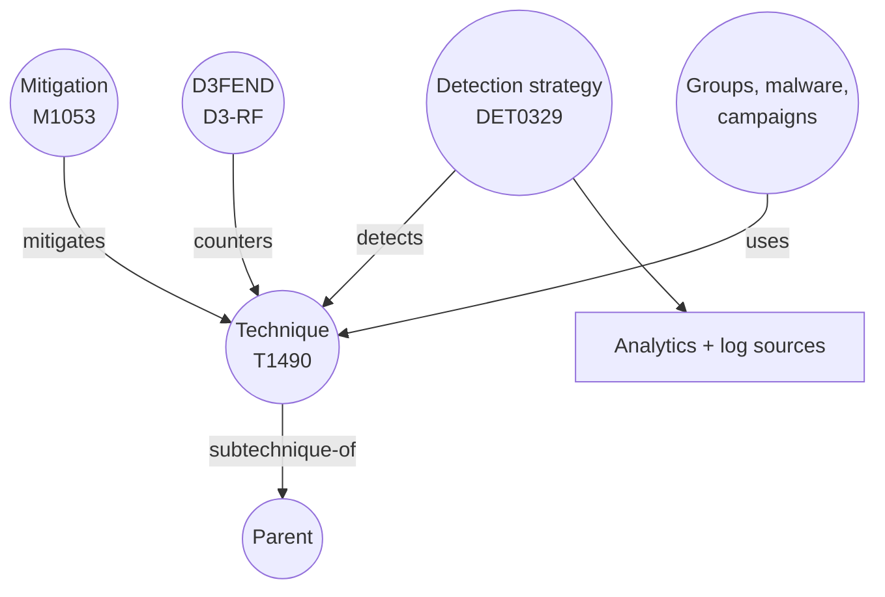

# 4. Where the knowledge comes from

The AI models in this project are good at reading and writing, but they are not the source of truth about attacks. The truth comes from two official, free MITRE datasets that ship inside the project as one small file: `data/kb.json.gz` (about 0.4 MB).

## The two sources

### MITRE ATT&CK v20 (October 2026)

Downloaded as STIX 2.1 JSON (a standard format for threat data) from the official `mitre-attack/attack-stix-data` GitHub repository. We use two domains:

| Domain | What it covers | Techniques we keep |
|---|---|---|
| Enterprise | Windows, Linux, macOS, cloud, SaaS, network devices | 706 |
| ICS | Factory and utility control systems (PLCs, HMIs, engineering workstations) | 104 |

"Keep" means active: revoked or deprecated techniques are dropped, but we remember which technique replaced each revoked one, so an old ID like `T1086` still resolves to its modern replacement.

From ATT&CK we take:

- **Techniques**: ID, name, tactics, platforms, description (citations removed, cut to 900 characters)
- **Mitigations**: 96, linked to techniques by `mitigates` relationships
- **Detection strategies**: 807, linked by `detects` relationships. Since ATT&CK v18 each strategy has **analytics**: per-platform descriptions of what to look for and which log sources to use (for example `WinEventLog:Security`, `auditd:SYSCALL`)
- **Usage counts**: how many threat groups, campaigns and malware families are known to use each technique

### MITRE D3FEND 1.6.0

D3FEND is the defensive twin of ATT&CK. Its public API answers "which defences work against this ATT&CK technique?". We ask it once for every technique (968 requests, cached in `data/raw/d3fend/`), and keep each defence's ID, name and group.

507 of the 810 techniques have D3FEND defences. The rest (mostly new or very specialised techniques) rely on ATT&CK mitigations only.

One wrinkle: D3FEND 1.6.0 still maps some techniques that ATT&CK has since revoked. The build script follows those to their replacements, so the defences are not lost.

## Turning it into a knowledge graph

`scripts/build_kb.py` does the whole job:



The dots are **nodes** and the arrows are **edges**. The graph lives in plain Python dictionaries keyed by ID, so a "graph walk" is a few dictionary lookups. That is why the enrich step takes under a millisecond and costs nothing.

### What a graph walk returns

`KnowledgeGraph.neighborhood("T1490")` returns everything the writer needs about one technique: name, tactics, platforms, description, the mitigations (with descriptions), the first two detection strategies (with their analytics and log sources), and the D3FEND defences grouped as Detect, Isolate, Evict, Restore, Harden, Deceive and Model. If a sub-technique has no mitigations or defences of its own, it inherits its parent's.

## Rebuilding it

```bash
python scripts/build_kb.py
```

It downloads the two ATT&CK files (about 60 MB, kept out of git), calls D3FEND for any technique not already cached, and writes `data/kb.json.gz`. When MITRE releases a new version, re-run it, re-run the tests, and re-run `scripts/index_pinecone.py` so the search index matches.

## Licence

ATT&CK is © The MITRE Corporation and reproduced under its Terms of Use. D3FEND is published by MITRE under the MIT licence. Atomic Red Team (used only for testing, page 7) is © Red Canary under the MIT licence.

Next: [Finding the right attack technique](05-finding-the-right-technique.md)
